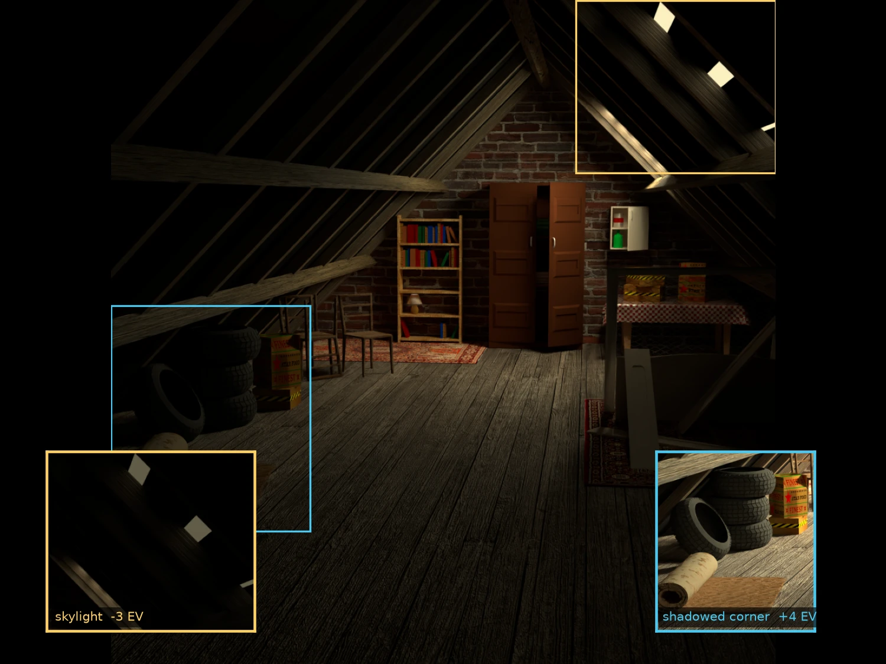

Rendering HDR Sequences
=======================

This tutorial shows how to render high-dynamic-range sequences suitable for downstream sensor emulation. HDR images store linear intensity values, unlike display-referred formats like PNG/JPEG.

Here, "HDR" refers specifically to the rendered **image** outputs (frames and composites), which are HDR when saved as linear ``.exr`` or ``.hdr`` instead of 8-bit PNG/JPEG. Auxiliary ground truths that are also stored as ``.exr`` (depth, normals, flow, ...) carry non-color data by definition and are not what this page is about.

|

HDR File Formats
----------------

HDR outputs can be saved as either ``.exr`` (OpenEXR) or ``.hdr`` (Radiance HDR):

.. list-table::
    :header-rows: 1

    * - Format
      - Extension
      - Color Depth
      - Color Mode
      - Compression
    * - OpenEXR
      - ``.exr``
      - 16 or 32 bit float
      - ``RGB`` or ``RGBA``
      - ``NONE``, ``PXR24``, ``ZIP``, ``PIZ``, ``RLE``, ``ZIPS`` (lossless); ``DWAA``, ``DWAB`` (lossy)
    * - Radiance HDR
      - ``.hdr``
      - 32 bit float (always)
      - ``RGB`` only
      - lossy RLE

The default ``DWAA`` codec for OpenEXR provides a good balance of compression and quality. For lossless archival use ``ZIP`` or ``PIZ``.

|

Using the Python API
--------------------

The :meth:`include_frames <visionsim.simulate.blender.BlenderService.exposed_include_frames>` method defaults to ``PNG`` with 8-bit color depth. Configure it for HDR output as follows:

.. code-block:: python

    # OpenEXR with lossy default codec (DWAA) at 32-bit float
    client.include_frames(file_format="OPEN_EXR", color_mode="RGB", bit_depth=32)

    # OpenEXR with lossless compression
    client.include_frames(file_format="OPEN_EXR", color_mode="RGB", bit_depth=32, exr_codec="ZIP")

    # Radiance HDR (always 32-bit float, RGB only)
    client.include_frames(file_format="HDR", color_mode="RGB")

Composite outputs can also be configured for HDR:

.. code-block:: python

    client.include_composites(file_format="OPEN_EXR", color_mode="RGB", bit_depth=16)
    client.include_composites(file_format="HDR", color_mode="RGB")

|

Using the CLI
-------------

The same configuration is available through the :meth:`blender.render-animation command <visionsim.cli.blender.render_animation>`. Render options are grouped under a ``config`` subcommand, so frame settings are passed as ``--config.frames.*``:

.. code-block:: bash

    # OpenEXR at 32-bit float, lossless ZIP compression
    visionsim blender.render-animation scene.blend ./output \\
        --config.frames.file-format OPEN_EXR \\
        --config.frames.bit-depth 32 \\
        --config.frames.exr-codec ZIP

    # Radiance HDR (always 32-bit float, RGB only)
    visionsim blender.render-animation scene.blend ./output \\
        --config.frames.file-format HDR \\
        --config.frames.color-mode RGB

Composites work the same way (provided the compositor setup does not do any tonemapping already) but must first be enabled:

.. code-block:: bash

    visionsim blender.render-animation scene.blend ./output \\
        --config.include-composites \\
        --config.composites.file-format OPEN_EXR \\
        --config.composites.bit-depth 32

.. note::

    ``bit-depth`` and ``exr-codec`` only apply to ``OPEN_EXR``. Radiance HDR is always 32-bit float and ``RGB``, so pairing it with ``bit-depth`` has no effect.

.. tip::

    Some sensor emulation might require HDR inputs. When running the downstream :doc:`sensor emulation pipeline <../sections/emulation>`, ensure the rendered frames are in ``.hdr`` or ``.exr`` format.

|

Example: an HDR render of the attic scene
-----------------------------------------

The `attic scene <https://drive.google.com/drive/folders/1gRxhL3rbGDTfgKytre8WkbBu-QDJFy15?usp=sharing>`_ is a 600-frame camera flythrough at 50 fps. Frame 410, below, looks up at the roof, where the skylights are many times brighter than the shadowed corner under the eaves, so one frame already spans the range this page is about. Render it as a 32-bit linear OpenEXR, at twice the resolution of the blend and four times its sample count:

.. code-block:: bash

    visionsim blender.render-frame attic.blend ./attic-frame \
        --frame 410 \
        --config.resolution-percentage 200 \
        --config.max-samples 1024 \
        --config.frames.file-format OPEN_EXR \
        --config.frames.bit-depth 32 \
        --config.frames.exr-codec ZIP

The :meth:`blender.render-frame command <visionsim.cli.blender.render_frame>` renders one frame index with the output layout and metadata ``blender.render-animation`` would write for it, so the result is a dataset holding a single ``attic-frame/frames/0000/410.exr``. The blend renders at 512x512, so ``resolution-percentage 200`` writes 1024x1024, and ``max-samples 1024`` keeps the pushed exposures below clean.

The file stores scene-linear radiance per channel: the values are unbounded, and the skylights in this frame reach about 1.8 while the darkest corners sit near ``1e-4``. That ratio is what an 8-bit file cannot carry, since PNG/JPEG clip everything above 1.0 and quantize the rest to 256 levels.

A single display-referred image cannot show both ends of that range: tone-mapping at one exposure either blows the skylights to flat white or crushes the shadowed corner to black. The figure therefore shows the same frame at three exposures cut from the one EXR:

   One 32-bit EXR frame at three exposures: zero stops, with the skylights cut three stops down and the shadowed corner four stops up. Re-exposing the linear pixels recovers what a single exposure loses at either end.

``visionsim`` reads ``.exr`` files with the ``OpenEXR`` package, and ``Dataset.load_data`` wraps the same call when you have a dataset on disk. To tone-map a whole rendered sequence for preview instead of composing a figure, use the transform command:

.. code-block:: bash

    visionsim transforms.tonemap-frames \\
        --input-dir attic-frame/frames \\
        --output-dir attic-frame-preview

The ``.exr`` frames under ``attic-frame/frames`` are the ones to hand to the sensor emulation pipeline; the PNGs in ``attic-frame-preview`` are only for display.

|

.. seealso::

    - :doc:`../sections/blender/rendering` for the render API these output settings belong to.
