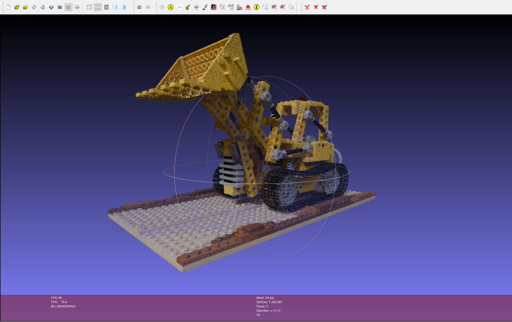
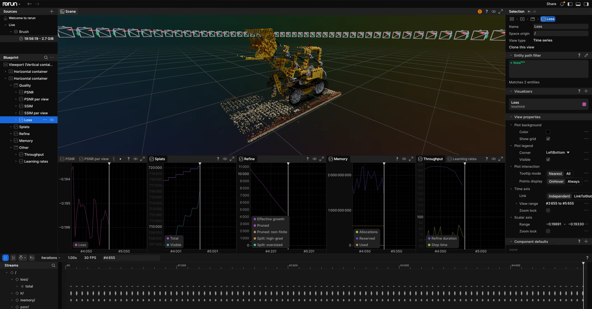
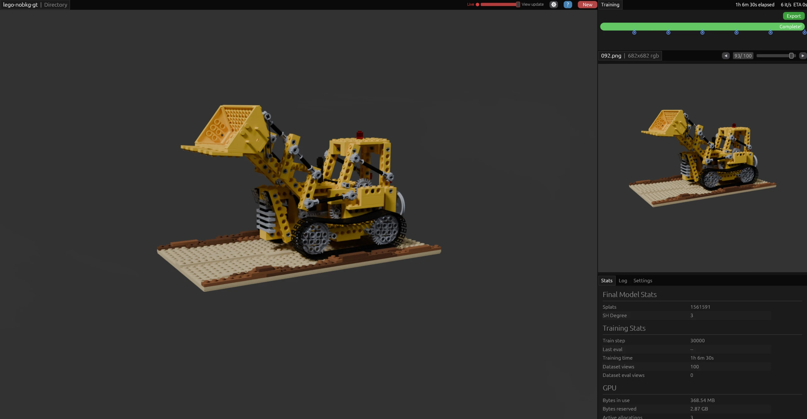

Training Data for NeRF and Gaussian Splatting
=============================================

NeRF and 3D Gaussian splatting pipelines train on a folder of images plus a ``transforms.json`` that holds a camera pose and intrinsics for every image. On captured data those poses have to be recovered with a structure-from-motion pass such as `COLMAP <https://colmap.github.io/>`_, which estimates them from the images and returns the scene up to an unknown scale. Rendering the sequence in VisionSIM does not need that step: the renderer knows where it put the camera, so it writes the exact pose and intrinsics it used, plus a per-frame depth map. A training set built this way needs no pose estimation and can carry ground-truth depth for depth-supervised runs.

This page renders a scene, folds the renderer's metadata into a `Nerfstudio <https://docs.nerf.studio/>`_-compatible ``transforms.json``, seeds a splat from the depth maps, and trains it with Brush. The lego scene comes from the original `NeRF paper <https://www.matthewtancik.com/nerf>`_.

|

Prerequisites
-------------

Blender >= 3.6 and ffmpeg on your ``PATH``, and ``visionsim`` installed, as covered in the :doc:`../quick-start`. You also need ``lego-nobkg.blend``, from the same `scenes folder <https://drive.google.com/drive/folders/1gRxhL3rbGDTfgKytre8WkbBu-QDJFy15?usp=sharing>`_ the quick start uses. It is pre-animated: the camera orbits the origin at ``Z=1`` with radius 5 over 100 frames, pointing at the truck the whole way.

|

Render the sequence
-------------------

Render 100 ground-truth RGB frames and, with ``include-depths``, an aligned depth map for each one:

.. code-block:: bash

    visionsim blender.render-animation lego-nobkg.blend lego-nobkg-gt/ --config.include-depths

The result is two sibling directories, each with its own metadata file:

.. code-block:: text

    lego-nobkg-gt/
    ├── frames/
    │   ├── 0000/000.png
    │   ├── ...
    │   └── transforms.db
    └── depths/
        ├── 0000/000.exr
        ├── ...
        └── transforms.db

``transforms.db`` is a SQLite database holding the camera trajectory, intrinsics and the data paths. See :doc:`../sections/datasets` for its schema. The renderer keeps the albedo frames and the depths in separate directories; the next step folds them into one training file.

|

Fold the frames and depths into one training file
-------------------------------------------------

Some NeRF and splatting tools read one file that points at both the color image and the depth map of each frame. :func:`dataset.merge <visionsim.cli.dataset.merge>` combines two datasets that share a camera and a pose per frame:

.. code-block:: bash

    visionsim dataset.merge \
        --input-files=lego-nobkg-gt/frames lego-nobkg-gt/depths \
        --names file_path depth_file_path \
        --output-file=lego-nobkg-gt/transforms.json \
        --up-axis=y

``--names`` renames the data key of each input, so the frames become the frame's ``file_path`` and the depths become its ``depth_file_path``. Paths are rewritten relative to the output file, giving ``lego-nobkg-gt/transforms.json`` with entries such as ``frames/0000/000.png`` and ``depths/0000/000.exr``. ``merge`` accepts the dataset directories as well as their metadata files, and only rewrites metadata; the images stay put.

``--up-axis=y`` rotates the poses into a Y-up world. The renderer works in Blender's Z-up world, while nerfstudio-family trainers assume Y-up: they lay their ground plane on ``XZ`` and look down ``-Y``, so an orbit that is horizontal in the render comes out as a vertical ring. Every command that writes poses or points from this dataset needs the same flag, so the training file and the point cloud below agree.

Both inputs are directories, so ``merge`` reads their ``transforms.db`` files directly. :func:`dataset.convert <visionsim.cli.dataset.convert>` rewrites one dataset's metadata between ``.db`` and ``.json`` if another tool wants it on its own, and takes the same ``--up-axis`` option.

Point the trainer at ``lego-nobkg-gt/``. `Nerfstudio <https://docs.nerf.studio/>`_ reads it with ``ns-train nerfacto --data lego-nobkg-gt`` and picks up the depth maps through ``depth_file_path``. Keep the tree free of a second ``transforms.json``; trainers that search recursively, Brush among them, would otherwise land on a copy inside ``frames/`` or ``depths/`` and read the wrong images.

The dataset format
^^^^^^^^^^^^^^^^^^

The output is a superset of the `Nerfstudio transforms format <https://docs.nerf.studio/quickstart/data_conventions.html#dataset-format>`_. The top-level intrinsics apply to every frame, and each frame carries its own pose and data paths:

.. code-block:: json

    {
      "fl_x": 960.0, "fl_y": 960.0,
      "cx": 320.0, "cy": 240.0,
      "w": 640, "h": 480,
      "frames": [
        {
          "file_path": "frames/0000/000.png",
          "transform_matrix": [[1, 0, 0, 0], [0, 1, 0, 0],
                               [0, 0, 1, 0], [0, 0, 0, 1]],
          "depth_file_path": "depths/0000/000.exr"
        }
      ]
    }

The keys, following the :doc:`dataset schema <../sections/datasets>`:

- ``fl_x``, ``fl_y``: focal length in pixels along X and Y.
- ``cx``, ``cy``: principal point in pixel coordinates.
- ``w``, ``h``: image width and height in pixels.
- ``c``: channel count (optional, for example 4 for RGBA).
- ``fps``: camera framerate (optional).
- ``frames``: one entry per frame, each with ``transform_matrix`` (the 4x4 pose), ``file_path`` (the color image, relative to this file), and any extra data paths ``merge`` added such as ``depth_file_path`` or ``mask_path``.

Poses follow the Blender, OpenGL and NeRF convention: ``+X`` right, ``+Y`` up, ``+Z`` back and away from the camera, so the viewing direction is ``-Z``. The :doc:`coordinate conventions <../sections/datasets>` section compares this with the OpenCV and COLMAP convention.

|

Seed the splat with the rendered depths
---------------------------------------

`Brush <https://github.com/ArthurBrussee/brush>`_ initializes its splats from a point cloud. Left to itself it guesses a training volume from the camera positions, which collapses for a flat orbit like this one, so hand it the geometry instead. :func:`dataset.to-pointcloud <visionsim.cli.dataset.to_pointcloud>` unprojects each depth map into world space and colors the points from the matching frame:

.. code-block:: bash

    visionsim dataset.to-pointcloud \
        --colors=lego-nobkg-gt/frames --depths=lego-nobkg-gt/depths \
        --output=lego-nobkg-gt/init.ply --up-axis=y

``--p`` sets the fraction of pixels to sample. The 0.15 default samples about 9.6 million pixels across these 800x800 frames, and roughly 1.4 million of them land in the cloud; the rest have no rendered surface behind them, carry the sentinel depth CYCLES writes, and are dropped. ``--up-axis=y`` puts the points in the same Y-up world as the merged poses, and records that in the file header, where Brush reads the vertical axis instead of guessing it. Brush picks up a file named ``init.ply``, so training starts from the geometry the renderer actually saw rather than from noise.

The result is an ordinary point cloud, so any point-cloud viewer opens it, `MeshLab <https://www.meshlab.net/>`_ included:

    ``init.ply`` opened in MeshLab, shaded with the colors from the rendered frames.

|

Train a Gaussian splat with Brush
---------------------------------

`Brush <https://github.com/ArthurBrussee/brush>`_ reads Nerfstudio datasets directly, so ``lego-nobkg-gt/`` goes straight in without a COLMAP pass or a format conversion:

.. code-block:: bash

    brush lego-nobkg-gt/ --total-steps=30000 --export-path=splats/ --export-name=lego-nobkg.ply

Brush writes the result to ``splats/lego-nobkg.ply``. Its defaults (30k steps, an export every 5000 steps, SH degree 3) are a reasonable starting point. ``--with-viewer`` opens the interactive UI, ``--rerun-enabled`` streams the run to `Rerun <https://rerun.io>`_, where the training figure below comes from, and ``--eval-split-every`` holds out every Nth frame for a PSNR/SSIM report. See the `Brush documentation <https://github.com/ArthurBrussee/brush>`_ for the rest of its options.

.. note::
    The poses are exact and ``init.ply`` already holds the rendered geometry, so the splat converges in a few thousand steps. The 30k default is headroom, not a requirement.

The splat trains from color alone. The ``depth_file_path`` entries survive the merge and Brush ignores them; they are there for trainers that supervise on depth, and for the ``init.ply`` above.

    Brush training the lego splat, logged to Rerun.

The exported ``.ply`` is a standard Gaussian splat file, and Brush will open it again as a viewer:

.. code-block:: bash

    brush splats/lego-nobkg.ply --with-viewer

    The trained splat in Brush's viewer, with the run's final stats.

|

Loading the data
----------------

The same file reads back through the :class:`Dataset <visionsim.dataset.Dataset>` API, which loads each frame and hands back its transform, including the depth path that ``merge`` added:

.. code-block:: python

    from visionsim.dataset import Dataset

    dataset = Dataset.from_path("lego-nobkg-gt/")
    for image, transform in dataset:
        depth_path = transform["depth_file_path"]
